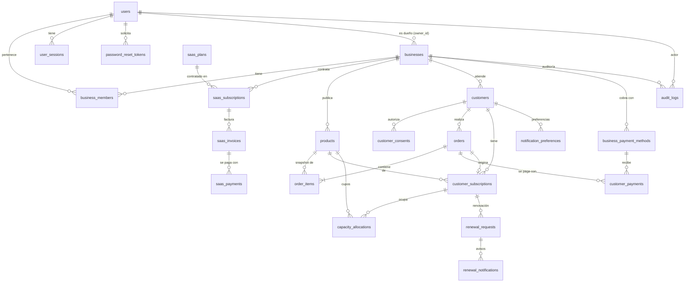

# Modelo de datos (PostgreSQL)

Convenciones:

* Claves primarias `UUID` (`DEFAULT gen_random_uuid()`, la aplicación también puede asignarlas).
* Fechas `TIMESTAMPTZ` (UTC). Fechas de calendario puras como `DATE` solo cuando no hay hora.
* Importes `NUMERIC(12,2)` en soles (`PEN`); nunca `float`.
* Estados como `VARCHAR` con `CHECK` (más fácil de migrar que tipos `ENUM` de PostgreSQL).
* `version BIGINT` para bloqueo optimista en tablas editables.
* Toda tabla de datos de negocio lleva `business_id` con FK e índice compuesto que empieza por `business_id`.
* Migraciones Flyway incrementales por fase: `V1__` identidad y multiempresa, `V2__` productos, etc.

## Diagrama entidad–relación

## Tablas

### Identidad y multiempresa (Fase 1 — `V1__identity_and_tenancy.sql`)

| Tabla | Columnas clave | Restricciones / índices |
|---|---|---|
| `users` | `id`, `full_name`, `email`, `password_hash`, `phone`, `platform_role` (`NULL`/`SUPER_ADMIN`), `status` (`ACTIVE`, `DISABLED`), `terms_accepted_at`, `privacy_accepted_at`, `version`, `created_at`, `updated_at` | `UNIQUE(email)`, `CHECK(email = lower(email))` |
| `businesses` | `id`, `owner_id → users`, `unique_code`, `slug`, `business_name`, `description`, `logo_url`, `cover_url`, `primary_color`, `whatsapp_number`, `time_zone`, `status` (`ACTIVE`, `SUSPENDED`), `version`, timestamps | `UNIQUE(slug)`, `UNIQUE(unique_code)`, `CHECK` formato de slug y color |
| `business_members` | `id`, `business_id`, `user_id`, `role` (`OWNER`, `STAFF`), `status` (`ACTIVE`, `REVOKED`), timestamps | `UNIQUE(business_id, user_id)`, índice por `user_id` |
| `user_sessions` | `id`, `user_id`, `token_hash` (SHA-256), `created_at`, `last_used_at`, `idle_expires_at`, `absolute_expires_at`, `revoked_at`, `ip_address`, `user_agent` | `UNIQUE(token_hash)`, índice `(user_id)` |
| `password_reset_tokens` | `id`, `user_id`, `token_hash`, `expires_at`, `used_at`, `created_at` | `UNIQUE(token_hash)` |
| `audit_logs` | `id`, `actor_id`, `business_id`, `action`, `entity_type`, `entity_id`, `metadata JSONB`, `ip_address`, `created_at` | índices `(business_id, created_at)`, `(actor_id, created_at)`; solo inserción |

### Facturación SaaS (Fase 6)

| Tabla | Columnas clave |
|---|---|
| `saas_plans` | `id`, `name`, `description`, `price`, `billing_period` (`MONTHLY`, `QUARTERLY`, `YEARLY`), `product_limit`, `customer_limit`, `admin_user_limit`, `feature_flags JSONB` (reportes, recordatorios, personalización), `is_active`, `sort_order` |
| `saas_subscriptions` | `id`, `business_id`, `plan_id`, `status` (`PENDING_PAYMENT`, `ACTIVE`, `PAST_DUE`, `SUSPENDED`, `CANCELLED`, `EXPIRED`), `start_at`, `expires_at`, `grace_until`, `plan_snapshot JSONB` — índice parcial único: una suscripción vigente por negocio |
| `saas_invoices` | `id`, `business_id`, `subscription_id`, `invoice_number`, `amount`, `period_start`, `period_end`, `status` (`OPEN`, `PAID`, `VOID`), `due_at` |
| `saas_payments` | `id`, `invoice_id`, `amount`, `method`, `transaction_reference`, `receipt_url`, `status`, `reported_at`, `verified_at`, `verified_by` |

### Catálogo y cupos (Fase 2 — `V2__catalog_and_payment_methods.sql`)

| Tabla | Columnas clave | Notas |
|---|---|---|
| `products` | `id`, `business_id`, `name`, `description`, `category`, `product_type` (`SUBSCRIPTION`, `ONE_TIME`), `price`, `duration_days`, `image_url`, `capacity_enabled`, `capacity`, `publication_status` (`DRAFT`, `PUBLISHED`, `ARCHIVED`), `is_available`, `version`, timestamps | `CHECK(product_type <> 'SUBSCRIPTION' OR duration_days > 0)`, `CHECK(NOT capacity_enabled OR capacity > 0)`; índice `(business_id, publication_status)` |
| `business_payment_methods` | `id`, `business_id`, `method` (`YAPE`, `PLIN`), `holder_name`, `phone`, `qr_image_url`, `is_enabled` | `UNIQUE(business_id, method)`; titular **declarado** por el vendedor |
| `capacity_allocations` | `id`, `business_id`, `product_id`, `allocation_status` (+ `order_id` y `customer_subscription_id` en Fases 3–4) (`RESERVED`, `OCCUPIED`, `RELEASE_PENDING`, `RELEASED`, `EXPIRED`), `reserved_until`, `released_at`, `version` | Disponibilidad = `capacity − count(RESERVED vigentes + OCCUPIED + RELEASE_PENDING)` calculada bajo `SELECT … FOR UPDATE` sobre `products` |

### Tienda, pedidos y pagos (Fase 3)

| Tabla | Columnas clave | Notas |
|---|---|---|
| `customers` | `id`, `business_id`, `full_name`, `phone` (E.164 `+51…`), `source` (`STOREFRONT`, `MANUAL`, `IMPORT`), `notes`, timestamps | `UNIQUE(business_id, phone)` — **sin** unicidad global de teléfono |
| `customer_consents` | `id`, `business_id`, `customer_id`, `purpose` (`PURCHASE_TERMS`, `DATA_PROCESSING`, `MARKETING_WHATSAPP`, `RENEWAL_REMINDERS`), `granted`, `source`, `policy_version`, `created_at`, `revoked_at` | Historial, nunca se sobrescribe |
| `order_number_sequences` | `business_id`, `year`, `last_value` | Numeración legible por negocio y año con bloqueo de fila |
| `orders` | `id`, `order_number`, `business_id`, `customer_id`, `kind` (`PURCHASE`, `RENEWAL`), `renewal_request_id`, `status` (`AWAITING_PAYMENT`, `PAYMENT_REPORTED`, `PAID`, `CANCELLED`, `EXPIRED`, `INCIDENT`), `total_amount`, `currency`, `idempotency_key`, timestamps | `UNIQUE(business_id, order_number)`, `UNIQUE(business_id, idempotency_key)` |
| `order_items` | `id`, `order_id`, `product_id`, `product_name_snapshot`, `product_type_snapshot`, `unit_price_snapshot`, `duration_snapshot`, `quantity` | Copia histórica inmutable |
| `customer_payments` | `id`, `business_id`, `order_id`, `payment_method_id`, `method_snapshot`, `holder_name_snapshot`, `receiver_phone_snapshot`, `amount`, `transaction_reference`, `receipt_url`, `status` (`PENDING`, `REPORTED`, `PENDING_VERIFICATION`, `VERIFIED`, `REJECTED`, `CANCELLED`, `REFUNDED`), `reported_at`, `verified_at`, `verified_by`, `rejection_reason`, `version` | Índice único parcial `(business_id, method_snapshot, transaction_reference) WHERE status IN ('PENDING_VERIFICATION','VERIFIED')` para detectar referencias duplicadas |

### Suscripciones y renovaciones (Fases 4–5)

| Tabla | Columnas clave | Notas |
|---|---|---|
| `customer_subscriptions` | `id`, `business_id`, `customer_id`, `product_id`, `order_id`, `origin` (`ORDER`, `MANUAL`, `IMPORT`), `paid_at`, `start_at`, `expires_at`, `duration_days`, `contracted_price`, `status` (`PENDING_ACTIVATION`, `ACTIVE`, `RENEWAL_PENDING`, `EXPIRED`, `CANCELLED`, `ENDED`), `last_renewed_at`, `notes`, `version` | Índices `(business_id, status, expires_at)` para tareas de vencimiento |
| `subscription_renewals` | `id`, `subscription_id`, `order_id`, `previous_expires_at`, `new_expires_at`, `created_at` | Historial de renovaciones |
| `renewal_requests` | `id`, `business_id`, `subscription_id`, `token_hash`, `token_expires_at`, `response` (`NONE`, `ACCEPTED`, `DECLINED`), `status` (`OPEN`, `AWAITING_PAYMENT`, `COMPLETED`, `DECLINED`, `EXPIRED`), `responded_at`, `created_at` | Índice único parcial: una solicitud abierta por suscripción y ciclo |
| `renewal_notifications` | `id`, `renewal_request_id`, `notification_type` (`REMINDER_3_DAYS`, `REMINDER_DUE_DAY`, `FAREWELL`), `channel` (`MANUAL_LINK`, `WHATSAPP_API`), `scheduled_at`, `sent_at`, `delivery_status` (`PENDING`, `SENT_MANUALLY`, `SENT`, `DELIVERED`, `FAILED`, `SKIPPED`), `provider_message_id` | `UNIQUE(renewal_request_id, notification_type)` evita duplicados |
| `notification_preferences` | `id`, `business_id`, `customer_id`, `channel`, `opted_out`, `updated_at` | Exclusiones |
| `seller_tasks` | `id`, `business_id`, `type` (`RELEASE_ACCESS`, `ACTIVATE_SERVICE`, `REVIEW_INCIDENT`), `entity_type`, `entity_id`, `status`, `due_at` | Tareas manuales pendientes para el vendedor |

## Integridad y concurrencia

* Todas las FK con `ON DELETE RESTRICT` salvo tablas dependientes puras (`order_items`,
  `user_sessions`) con `CASCADE`. No se eliminan ventas al archivar productos.
* Los importes de pedidos y pagos se copian del producto **en el servidor**.
* Transiciones de estado críticas mediante `UPDATE … WHERE id = ? AND status = ?` y comprobación de filas afectadas.
