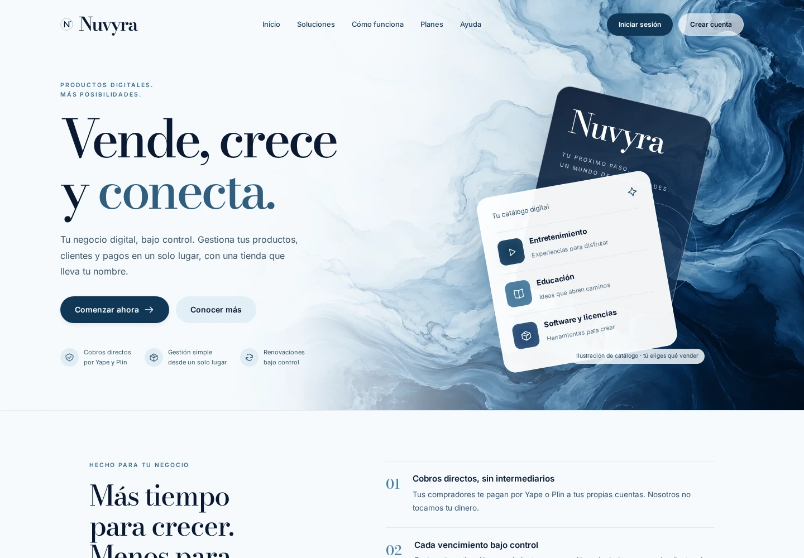
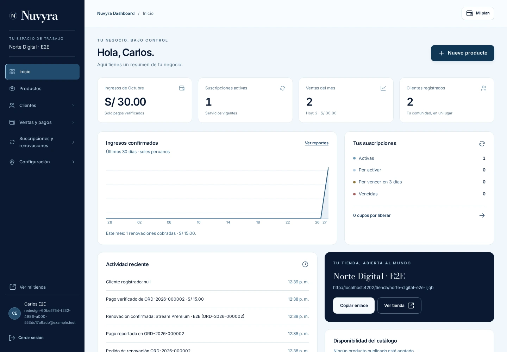

# Rediseño editorial de Nuvyra

La comparación parte de `f3b06f2` (fases 1–7 y marca Nuvyra). Se mantienen el backend, la base de datos,
los contratos REST y las reglas comerciales. Los cambios se concentran en Angular y el sistema visual.

Las capturas usan una base local desechable con cuentas, productos y planes **E2E**. Son datos de
prueba identificados, no ventas reales. Las vistas anteriores y nuevas consultan el mismo negocio.

## Antes y después

| Pantalla | Antes | Después |
|---|---|---|
| Portada | [Abrir](before-landing.webp) | [Abrir](after-landing.webp) |
| Acceso | [Abrir](before-login.webp) | [Abrir](after-login.webp) |
| Panel del vendedor | [Abrir](before-dashboard.webp) | [Abrir](after-dashboard.webp) |
| Tienda pública | [Abrir](before-store.webp) | [Abrir](after-store.webp) |
| Tienda móvil | [Abrir](before-mobile.webp) | [Abrir](after-mobile.webp) |





## Pruebas reproducibles

Validación del cambio: **150 pruebas backend**, **68 pruebas frontend** y **6 recorridos E2E**
aprobados. La compilación de producción de Angular también finaliza correctamente. Estas pruebas
verifican el cambio visual y los recorridos descritos; no sustituyen la revisión previa al despliegue comercial.

Requisitos: JDK 21, Node compatible con Angular 21, Docker y PostgreSQL local. Usar exclusivamente
un entorno de pruebas; la suite crea negocios, planes, pagos e importaciones.

```bash
cd backend
./gradlew test
cd ../frontend
npm ci
npm test -- --watch=false
npm run build
npx playwright install chromium
```

Iniciar backend y Angular con el proxy habitual. Para los recorridos E2E, el backend local necesita
un SUPER_ADMIN de pruebas, configurado mediante `APP_BOOTSTRAP_SUPER_ADMIN_EMAIL` y
`APP_BOOTSTRAP_SUPER_ADMIN_PASSWORD`. Acelerar únicamente en ese entorno el programador de renovaciones:

```bash
APP_RENEWALS_JOB_INTERVAL=PT1S APP_RENEWALS_JOB_INITIAL_DELAY=PT1S ./gradlew bootRun
```

Con ambos servidores iniciados, configurar en la terminal `E2E_ADMIN_EMAIL` y `E2E_ADMIN_PASSWORD`
con las credenciales del administrador de pruebas y ejecutar:

```bash
cd frontend
E2E_BASE_URL=http://localhost:4200 npm run e2e
```

La suite rechaza destinos distintos de localhost/127.0.0.1. Los planes y cuentas de cobro de las
pruebas se crean desde las API normales del SUPER_ADMIN; no se añade ningún acceso especial al backend.
Los códigos de operación son ficticios y exclusivos del entorno E2E: no se realizan transferencias
bancarias ni se envían mensajes mediante Meta.

Los tres escenarios se ejecutan en escritorio y móvil:

1. Portada, planes publicados, acceso, validación de formularios, registro, recuperación y navegación.
2. Compra sin cuenta, filtros, verificación manual, renovación con el mismo cupo y dashboard real.
3. Catálogo, formularios, clientes, suscripciones, reportes, facturación, configuración, WhatsApp,
   importación CSV con vista previa y confirmación, superadministración y activación del plan SaaS.

Las capturas comprueban además el ancho de página a 360 y 768 píxeles. El informe de Playwright
incluye capturas de las pantallas recorridas y trazas de los fallos. Axe comprueba WCAG A/AA en
portada, acceso, tienda, checkout y dashboard; no se omiten reglas de contraste ni fallos graves.

Los artefactos generados quedan en `frontend/test-results` y `frontend/playwright-report`, excluidos
del repositorio. El origen del arte y las fuentes se documenta en el sistema visual.
