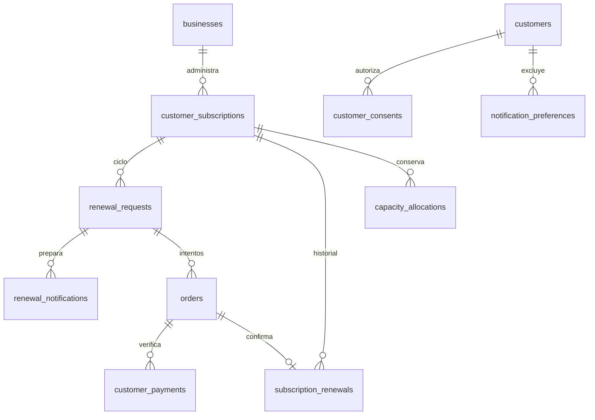

# Continuación de Fase 5 — Renovaciones y disponibilidad

Se conserva el monolito modular existente: Angular 21 + Kotlin/Spring Boot + PostgreSQL.
No se reinician las fases 1–4 ni se activa la comercialización SaaS de la fase 6.

## Arquitectura y límites del incremento

- `renewals`: solicitudes por ciclo, plazo de gracia, respuesta, avisos manuales e historial cobrado.
- `subscriptions`: fechas reales de servicio, vencimiento, cancelación y extensión tras pago verificado.
- `payments`: el vendedor comprueba la transferencia; reportar un código nunca verifica el dinero.
- `capacity`: conserva la asignación al renovar y exige confirmar el retiro del acceso para liberarla.
- Angular consume las API reales y mantiene las rutas con carga diferida existentes.
- Los cobros SaaS siguen separados de estos pagos de compradores; su implementación corresponde a fase 6.



Las tablas, UUID, relaciones e índices de V1–V5 permanecen. La migración **V6** añade
`renewal_requests.grace_expires_at`, calculada para solicitudes existentes desde el vencimiento
original del token. El índice parcial por fecha permite cerrar solicitudes por lotes. Los ajustes
posteriores del negocio afectan nuevas solicitudes y respetan los plazos ya comunicados.
El token sigue siendo HMAC-SHA256 sobre un UUID aleatorio con secreto externo; solo se almacena su hash.
No se escriben tokens en texto plano en la base. Cambiar el secreto invalida los enlaces existentes.

## Contratos y rutas

Todos los contratos están bajo `/api/v1`; los importes y la duración se resuelven en el servidor.

| Contrato | Comportamiento |
|---|---|
| `GET /public/renewals/{token}` | `canRespond` y `canPay` consideran el plazo y el estado real de la suscripción y el negocio |
| `POST /public/renewals/{token}/response` | Aceptar no amplía fechas. Rechazar conserva el periodo pagado. Un pago reportado requiere revisión antes de desistir |
| `POST /public/renewals/{token}/orders` | Reutiliza el pedido abierto del ciclo; no descuenta un segundo cupo |
| `POST /public/orders/{token}/payment-report` | Valida que la renovación siga abierta, aunque todavía no se haya ejecutado el job |
| `POST /payments/{id}/verify` | Extiende únicamente la suscripción autorizada; no reactiva una cancelada ni una solicitud cerrada |
| `GET /subscriptions/{id}/renewals?page=&size=` | Nuevo historial paginado: pedido, importe, fecha confirmada y vencimientos anterior/nuevo. Solo el negocio propietario |
| `GET /renewals/notifications?page=&size=` | Devuelve `whatsappUrl: null` si falta autorización vigente; el aviso puede omitirse |
| `POST /renewals/notifications/{id}/sent` | Exige consentimiento, fecha alcanzada y aviso pendiente; abrir WhatsApp no confirma envío |

Rutas Angular: `/renovar/:token`, `/pedido/:token`, `/panel/renovaciones`,
`/panel/clientes/:id` y `/panel/configuracion/renovaciones`. El historial se abre bajo demanda dentro
de cada suscripción; no añade una página innecesaria. Las bandejas de renovaciones, avisos y cupos
permiten recorrer todas las páginas y reintentar errores de carga. Se conserva la paleta y tipografía
legal del sistema visual existente.

## Reglas reparadas

1. El plazo se valida en cada operación; un retraso del programador no prolonga las compras.
2. Un pago ya reportado conserva el cupo para revisión incluso si termina la gracia. Después de un
   rechazo, la solicitud puede vencer; no se libera un acceso externo sin confirmación del vendedor.
3. Una suscripción cancelada o con acceso retirado no se reactiva por un enlace anterior.
4. El job recupera suscripciones vencidas dentro de la gracia tras reinicios, aunque el job de
   vencimiento haya corrido primero. Abrir solicitudes simultáneamente se serializa por suscripción.
5. No se entrega un enlace de recordatorio sin consentimiento vigente, ni se permite registrar envío.
   Volver a permitir avisos no inventa un consentimiento que nunca se obtuvo.
6. Una intención aceptada que no se pagó se mantiene en «Aceptaron», con el plazo cerrado; no se
   cuenta como «Sin respuesta». Los reportes distinguen la decisión del cliente del pago.
7. Los avisos recuperados después de su fecha indican «venció el…» en la zona del negocio, sin
   afirmar que el vencimiento es hoy.
8. El historial y todas las acciones administrativas se limitan por el negocio resuelto en el servidor.

## Verificación reproducible

```bash
cd backend
./gradlew test                 # Java 21 JDK y Docker (Testcontainers/PostgreSQL)
cd ../frontend
npm ci
npm test -- --watch=false
npm run build
npx playwright install chromium
npm run e2e                   # Escritorio y móvil, instancias locales desechables
```

La suite Playwright usa PostgreSQL y el backend real sin interceptar las API. No realiza transferencias
bancarias: los códigos de operación son datos de prueba, y se ejercita la aprobación manual del
vendedor en la interfaz. Las cuentas y productos
creados llevan nombres E2E y son datos exclusivos de pruebas. Ejecutar **solo contra un entorno de
pruebas desechable**, ya que se crean negocios y ventas.

Antes de `npm run e2e`, iniciar una base local de pruebas, el backend en `http://localhost:8080`
y Angular con `npm start` en `http://localhost:4200`. Para que las pruebas no esperen los 15 minutos
del programador, iniciar el backend de pruebas así (usando las credenciales de esa base local):

```bash
APP_RENEWALS_JOB_INTERVAL=PT1S APP_RENEWALS_JOB_INITIAL_DELAY=PT1S ./gradlew bootRun
```

`E2E_BASE_URL` permite cambiar el origen de Angular. La suite conserva trazas y capturas al fallar,
y una captura del resultado confirmado en cada tamaño. Las pruebas de integración verifican también
rechazo, exclusión de avisos, gracia agotada, aislamiento, concurrencia y conservación del cupo.

## Pendientes fuera de este incremento

- Fase 6: planes y pagos SaaS, límites, bloqueo por falta de plan y superadministración.
- Fase 7: WhatsApp Business Platform, webhooks e integraciones de pagos oficialmente autorizadas.
  No se envían mensajes automáticamente ni se infiere un pago leyendo una captura.
- Despliegue comercial: SMTP real, dominio/HTTPS, secretos, copias automatizadas y revisión de los textos
  legales. Las fuentes comerciales solo se incorporarán con licencia; se conservan las alternativas legales.
- Varias instancias: bloqueo distribuido de jobs y rate limiting compartido, ya registrados en el backlog.
